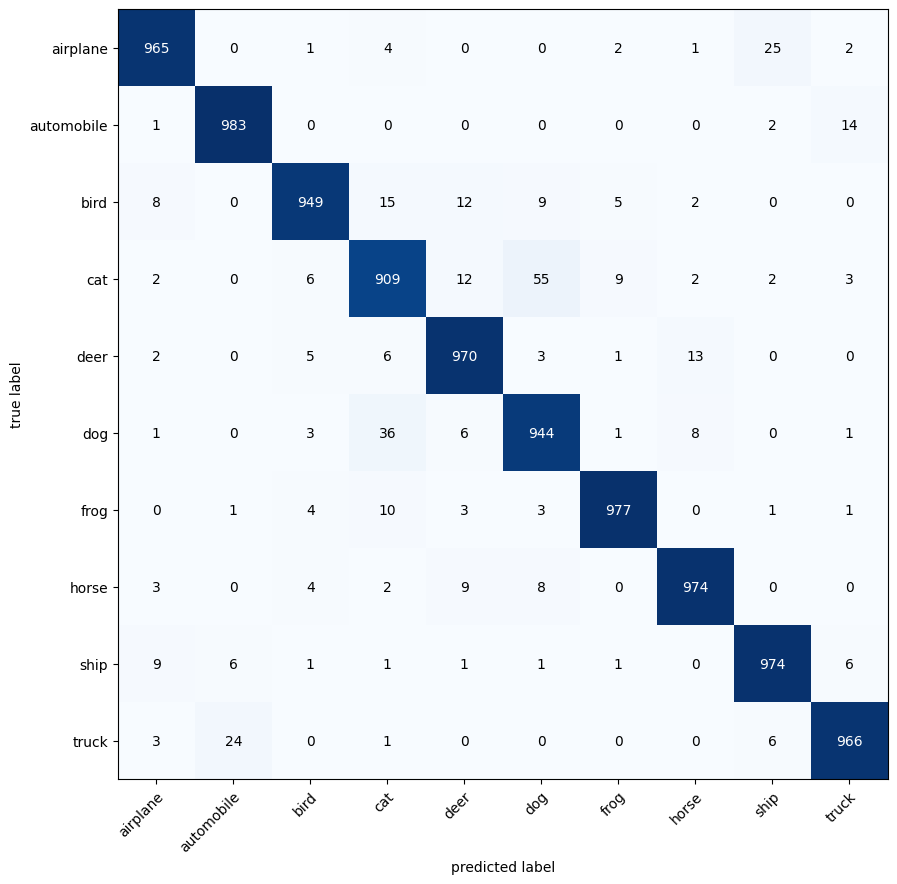
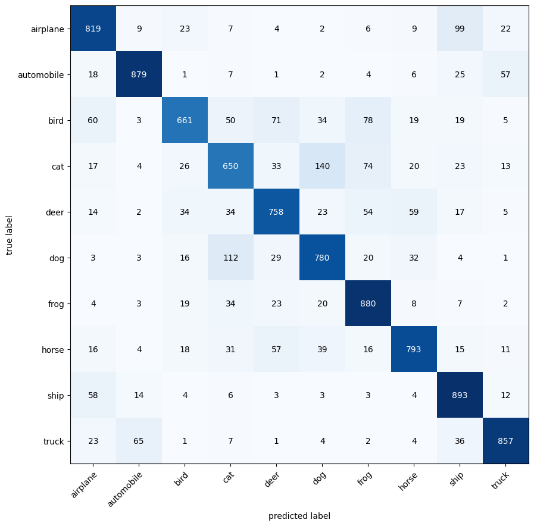
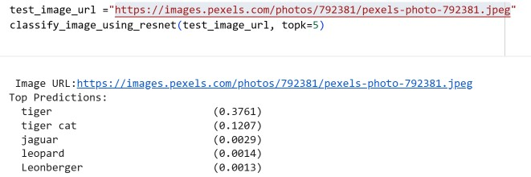

# CIFAR-10 Image Classification Using Transfer Learning with ResNet-18

A computer vision project that explores image classification on the CIFAR-10 dataset using **PyTorch** and **Transfer Learning** with a pretrained **ResNet-18** model.

The project demonstrates two widely used transfer learning approaches:

- **Fine-Tuning** a pretrained ResNet-18 model on the CIFAR-10 dataset.
- **Feature Extraction** by freezing pretrained layers and training only a new classifier head.

Model performance is evaluated using test-set accuracy and confusion matrices. The repository also includes a separate inference notebook for classifying custom images using a trained model.

---

## Project Objectives

The primary goals of this project are to:

- Understand transfer learning in computer vision
- Compare Fine-Tuning and Feature Extraction approaches
- Train and evaluate image classifiers using PyTorch
- Analyze model performance using confusion matrices
- Perform inference on custom images using a trained model

---

## Transfer Learning Approaches

### 1. Fine-Tuning

In this approach:

- A pretrained ResNet-18 model is loaded.
- The final fully connected layer is replaced to match the CIFAR-10 classes.
- All layers remain trainable.
- The entire network is retrained on the CIFAR-10 dataset.

This allows the pretrained feature representations to adapt to the target dataset.

### 2. Feature Extraction

In this approach:

- A pretrained ResNet-18 model is loaded.
- All pretrained layers are frozen.
- The final fully connected layer is replaced with a new classifier.
- Only the new classification layer is trained.

This significantly reduces training time while leveraging features learned from large-scale image datasets.

---

## Transfer Learning Strategy

To preserve the useful feature representations learned during pretraining, a relatively small learning rate was used throughout training. Lower learning rates prevent large weight updates that could overwrite the pretrained knowledge of the network.

The project also utilizes the **ReduceLROnPlateau** learning rate scheduler to automatically decrease the learning rate when validation performance stops improving. This enables faster learning during the early stages of training while allowing finer adjustments as the model approaches convergence.

Key benefits of this strategy include:

- Stable training behavior
- Better preservation of pretrained features
- Improved convergence
- Reduced risk of overfitting
- Better generalization on unseen data
- 
## Dataset

This project uses the **CIFAR-10** dataset.

### Dataset Statistics

| Property | Value |
|-----------|---------|
| Total Images | 60,000 |
| Training Images | 50,000 |
| Test Images | 10,000 |
| Image Size | 32 × 32 |
| Channels | RGB (3-Channel Color Images) |
| Classes | 10 |`

### CIFAR-10 Classes

- Airplane
- Automobile
- Bird
- Cat
- Deer
- Dog
- Frog
- Horse
- Ship
- Truck

---

## Features

### Model Training

The training notebook includes:

- Transfer learning using ResNet-18
- Fine-Tuning of the full network
- Feature extraction with frozen layers
- Learning rate scheduling using ReduceLROnPlateau
- Conservative learning rates to preserve pretrained weights
- Training and evaluation on CIFAR-10
- Accuracy comparison between approaches
- Confusion matrix generation and analysis
- 
### Model Evaluation

The project evaluates model performance using:

- Test Accuracy
- Class-wise Predictions
- Confusion Matrices
- Visual comparison between Fine-Tuning and Feature Extraction approaches

### Custom Image Classification

The inference notebook demonstrates:

- Loading a trained pretrained model
- Loading and preprocessing custom images
- Applying normalization and image transformations
- Running model inference
- Generating Top-5 predictions with confidence scores
- Visualizing the most probable classes

The notebook uses ImageNet class labels to provide the five most likely predictions along with their associated probabilities.

### Inference Features

- Single image classification 
- Top-5 prediction generation 
- Confidence score reporting 
- Image preprocessing and normalization
- ImageNet class mapping

---

## Project Structure

```text
.
├── Fine_Tuning_PreTrained_ResNet.ipynb
├── Image_Prediction_using_ResNet.ipynb
├── images/
│   ├── confusion_matrix_finetuning.png
│   ├── confusion_matrix_feature_extraction.png
│   └── sample_prediction.png
└── README.md
```

---

## Technologies Used

- Python
- PyTorch
- Torchvision
- NumPy
- Matplotlib
- Pillow (PIL)
- Scikit-learn
- Jupyter Notebook

---

## Training Workflow

### Fine-Tuning

```text
CIFAR-10 Dataset
        ↓
Data Augmentation
        ↓
Pretrained ResNet-18
        ↓
Replace Final FC Layer
        ↓
Train Entire Network
        ↓
Evaluate Performance
```

### Feature Extraction

```text
CIFAR-10 Dataset
        ↓
Data Augmentation
        ↓
Pretrained ResNet-18
        ↓
Freeze Pretrained Layers
        ↓
Replace Final FC Layer
        ↓
Train Classifier Layer
        ↓
Evaluate Performance
```

---

## Inference Workflow

```text
Input Image
      ↓
Image Preprocessing
      ↓
Trained ResNet-18 Model
      ↓
Softmax Prediction
      ↓
Predicted CIFAR-10 Class
```

---

## Results

### Fine-Tuning Confusion Matrix

<p align="center">
  
</p>

---

### Feature Extraction Confusion Matrix

<p align="center">
  
</p>


---

### Performance Comparison

| Metric        | Fine-Tuning   | Feature Extraction |
|---------------|---------------|--------------------|
| Test Accuracy | 96.13%        | 79.74%             |
| Total Time    | 3462.86 seconds | 2457.97 min        |


---

### Sample Prediction

<p align="center">
  
</p>

---

## Learning Outcomes

Through this project, I gained practical experience in:

- Transfer Learning with pretrained CNNs
- Learning Rate Scheduling using ReduceLROnPlateau
- Fine-Tuning vs Feature Extraction strategies
- Top-5 Image Classification Inference
- Confidence Score Interpretation

---

## References

### Transfer Learning Tutorial

- https://www.youtube.com/watch?v=7nidEDz2Ysk

### Image Prediction Tutorials

- https://www.youtube.com/watch?v=Xp0LtPBcos0
- https://www.youtube.com/watch?v=rgBu8CbH9XY

### Documentation

- https://pytorch.org/
- https://pytorch.org/tutorials/
- https://pytorch.org/vision/stable/index.html

---

## License

This project was created for educational purposes and personal learning in Deep Learning, Computer Vision, and Transfer Learning using PyTorch.
